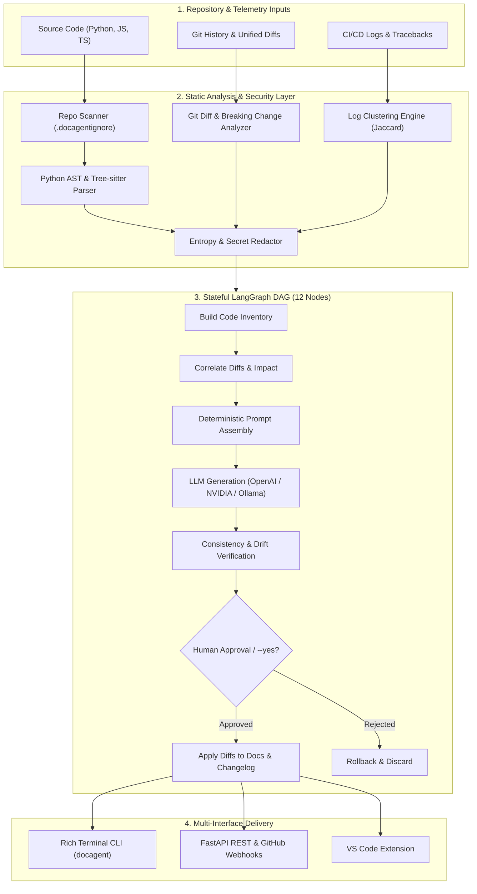

# 🤖 DocAgent: Intelligent Documentation Agent

<div align="center">

[](https://www.python.org/)
[](https://fastapi.tiangolo.com/)
[](https://github.com/langchain-ai/langgraph)
[](https://tree-sitter.github.io/)
[](file:///tests/unit)
[](file:///vscode-extension)
[](LICENSE)

**Autonomous, Evidence-Grounded Documentation Agent with AST Code Analysis, Git Diff Tracking, CI/CD Log Clustering, and Zero-Hallucination Consistency Verification.**

[Key Features](#-key-features) • [Architecture](#-architecture) • [Quickstart](#-quickstart) • [CLI Reference](#-cli-reference) • [API & Webhooks](#-rest-api--webhooks) • [VS Code Extension](#-vs-code-extension) • [Documentation](#-documentation-index)

</div>

---

## 📌 Overview

Documentation is often the most neglected part of software engineering. As codebases evolve, documentation silently drifts: parameter signatures change, routes are deleted, and new environment variables go undocumented. Existing AI documentation tools often suffer from **two critical flaws**:
1. **Unsafe Execution**: They run untrusted code to inspect runtime state, opening severe security attack surfaces.
2. **Hallucination & Drift**: They generate generic, outdated, or hallucinated claims that do not correspond to the actual codebase.

**DocAgent solves this with deterministic evidence grounding.** 

DocAgent inspects repositories **without code execution** using Python AST and Tree-sitter grammars (Python, JavaScript, TypeScript). It extracts live symbols, routes, and config structures, parses Git diffs to detect breaking changes, clusters CI/CD build logs to generate troubleshooting guides, and verifies every documentation claim before changes are applied.

---

## ✨ Key Features

- 🧠 **Zero-Execution Static AST Parsing**: Extracts classes, methods, docstrings, route decorators (FastAPI, Flask, Express.js), and Pydantic `BaseSettings` without calling `eval()`, `exec()`, or importing untrusted modules.
- 🛡️ **Built-in Secret Redaction**: Intercepts 12+ categories of credentials (AWS keys, GitHub tokens, Slack webhooks, JWTs, private keys, database URIs) using pattern heuristics and Shannon entropy calculations before LLM processing.
- ⚡ **Git Diff & Breaking Change Analysis**: Parses unified git diffs to detect modified function parameters, removed exports, and signature alterations, automatically generating semantically grounded `CHANGELOG.md` updates.
- 🔍 **CI/CD Log Traceback Clustering**: Ingests build and application logs, sanitizes memory addresses, normalizes line numbers, and clusters repetitive failures via Jaccard similarity into an automated `TROUBLESHOOTING.md`.
- ⚖️ **Zero-Drift Consistency Verification**: Extracts markdown claims (functions, routes, classes, env vars) and cross-verifies them against the AST code inventory. Any missing or obsolete symbol is flagged with a severity score and suggested fix.
- 🔄 **LangGraph Stateful Orchestration**: Powered by a 12-node LangGraph Directed Acyclic Graph (DAG) with checkpoints, human-in-the-loop review (`APPROVED`/`REJECTED`), and branch generation.
- 🔌 **Triple-Interface Architecture**: 
  - **CLI**: Rich terminal UI with colorized diffs, interactive approval, and file watching.
  - **FastAPI Server**: Asynchronous background jobs, webhook handlers (`push`, `pull_request`), and REST endpoints.
  - **VS Code Extension**: In-editor documentation generation, live status bar health indicator, and side-by-side diff previews.

---

## 🏗️ Architecture

DocAgent operates on a layered, modular architecture where all interfaces (CLI, REST API, VS Code) share the identical deterministic analysis and orchestration engine.



---

## 🚀 Quickstart

### Prerequisites
- Python **3.10+**
- Git installed and configured
- Node.js 18+ (optional, only for building the VS Code extension)

### 1. Installation

```bash
# Clone the repository
git clone https://github.com/your-username/documentation-agent.git
cd documentation-agent

# Create and activate a virtual environment
python -m venv .venv
# On Windows:
.venv\Scripts\activate
# On Linux / macOS:
source .venv/bin/activate

# Install dependencies in editable mode
pip install -e .
```

### 2. Configure Environment

Copy the template configuration and specify your preferred LLM provider:

```bash
cp .env.example .env
```

Edit `.env`:
```ini
ENVIRONMENT=development
LOG_LEVEL=INFO

# LLM Provider (openai, nvidia, or local/ollama)
LLM_PROVIDER=openai
LLM_API_KEY=sk-your-openai-api-key
LLM_MODEL=gpt-4o-mini
```

*(Optional: Supports NVIDIA NIM with `LLM_BASE_URL=https://integrate.api.nvidia.com/v1` and `LLM_MODEL=meta/llama-3.3-70b-instruct`)*

### 3. Verify Installation

```bash
docagent --help
```

---

## 💻 CLI Reference

DocAgent includes a full-featured terminal CLI built with **Typer** and **Rich**.

### `docagent init`
Initializes DocAgent in a project repository, creating a `.docagentignore` file and ensuring the `docs/` directory exists.
```bash
docagent init --path /path/to/project
```

### `docagent analyze`
Performs read-only AST parsing and outputs discovered symbols, API routes, and environment configuration in formatted tables.
```bash
docagent analyze --path .
```

### `docagent generate`
Executes the LangGraph documentation pipeline. Shows unified diffs for review before applying changes to disk.
```bash
# Interactive review mode:
docagent generate --path .

# Auto-approve mode (ideal for CI/CD pipelines):
docagent generate --path . --yes
```

### `docagent validate`
Checks existing markdown documents against the codebase to detect drift, hallucinated symbols, obsolete dependencies, or missing routes.
```bash
docagent validate --path .
```
*Returns exit code `1` if critical discrepancies are found, making it ideal as a CI gate.*

### `docagent logs`
Parses raw application or CI/CD logs, sanitizes sensitive data, fingerprints stack traces, and outputs clustered error groups with remediation suggestions.
```bash
docagent logs /path/to/ci-build.log
```

### `docagent watch`
Watches local repository files for changes and automatically flags documentation drift on save.
```bash
docagent watch --path . --interval 3
```

---

## 🌐 REST API & Webhooks

DocAgent includes a production-grade **FastAPI** backend for CI/CD automation, GitHub App integrations, and team workflows.

### Starting the Server
```bash
uvicorn docagent.api.main:app --reload --port 8000
```
Interactive Swagger documentation is available at `http://localhost:8000/docs`.

### Primary API Endpoints

| Method | Endpoint | Description |
| :--- | :--- | :--- |
| `GET` | `/healthz` | Health check endpoint returning status and uptime. |
| `POST` | `/api/v1/jobs/` | Triggers asynchronous repository documentation analysis. |
| `GET` | `/api/v1/jobs/{job_id}` | Retrieves job status, state graph checkpoints, and proposed diffs. |
| `POST` | `/api/v1/jobs/{job_id}/approve` | Submits human-in-the-loop approval (`APPROVED` or `REJECTED`). |
| `POST` | `/api/v1/jobs/validation/check` | Runs validation on a target repository and returns drift findings. |
| `POST` | `/api/v1/webhooks/github` | Receives and validates GitHub HMAC-signed webhook events. |

### GitHub App Webhook Integration
When configured with GitHub Webhooks (`push` and `pull_request` events):
1. **PR Opened / Synchronized**: DocAgent compares the base branch against the PR head, detects modified symbols, validates documentation completeness, and posts an automated review comment.
2. **Push to Main**: DocAgent computes the commit diff, updates `docs/` and `CHANGELOG.md`, and opens a pull request with the branch prefix `docagent/update-*`.

---

## 🧩 VS Code Extension

The repository includes a native VS Code extension located in [`vscode-extension/`](file:///vscode-extension).

### Features
- 🚀 **Generate Documentation**: Run DocAgent generation directly from the Command Palette (`DocAgent: Generate Documentation`).
- 👁️ **Unified Diff Preview**: Inspect side-by-side markdown differences in the editor before saving.
- 🛡️ **Drift Checker**: Status bar indicator alerting you when open code changes cause documentation drift.
- 📋 **Log Analyzer**: Right-click any `.log` file in the Explorer and select `DocAgent: Analyze Log File` to view error clusters.

### Building & Running Extension
```bash
cd vscode-extension
npm install
npm run compile
```
Press `F5` in VS Code to launch the extension in the Extension Development Host.

---

## 🔒 Security Model & Evidence Grounding

DocAgent was designed with a security-first posture:

1. **Zero Runtime Execution**: Never invokes `eval()`, `exec()`, subprocess execution of repository code, or module imports. Analysis relies exclusively on AST parsing (`ast` and `tree-sitter`).
2. **Path Containment**: All file operations are checked with strict path validation against the repository root, preventing directory traversal (`../../`) and symlink attacks.
3. **Secret Redaction**:
   - Matches pattern-based secrets (AWS Access Keys, GitHub Tokens, Slack Hooks, Private Keys, JWTs, Passwords).
   - Shannon entropy analysis detects randomized secret strings.
   - Credentials are permanently masked (`[REDACTED_...]`) prior to LLM submission.
4. **Zero-Drift Validator**: Bi-directional claim validation verifies that every documented function, class, route, and environment variable physically exists in the codebase AST.

---

## 🧪 Testing Suite

DocAgent is backed by 45+ comprehensive automated tests covering all modules:

```bash
# Run unit & integration tests
pytest tests/unit/ -v
```

### Test Coverage Highlights:
- ✅ **Phase 1**: Repo scanner, path containment, secret redaction, Python AST, Tree-sitter JS/TS parser.
- ✅ **Phase 2**: Git diff parser, inventory correlation, breaking change detection.
- ✅ **Phase 3**: Deterministic template engine and mock LLM generation.
- ✅ **Phase 4**: Documentation drift detection, claim extractor, obsolete dependency warnings.
- ✅ **Phase 5**: Python & JavaScript stack trace clustering and troubleshooting guide rendering.
- ✅ **Phase 6**: LangGraph DAG end-to-end execution, checkpoints, and human approval pause.
- ✅ **Phase 7**: FastAPI endpoints, job state queries, and GitHub HMAC webhook validation.

---

## 📁 Repository Structure

```
Documentation Agent/
├── docagent/                   # Core Python Engine
│   ├── analyzer/               # Static AST, Tree-sitter, Git Diff, & Log Parsers
│   ├── api/                    # FastAPI Server, Job Routes, & GitHub Webhooks
│   ├── cli/                    # Typer & Rich CLI Implementation
│   ├── core/                   # Configuration (Pydantic BaseSettings), Logging, Exceptions
│   ├── database/               # SQLAlchemy Models & SQLite/Postgres Sessions
│   ├── generator/              # Template Engine & LLM Clients (OpenAI / NVIDIA)
│   ├── orchestration/          # LangGraph DAG Nodes, State Graph, & Checkpoints
│   ├── security/               # Path Traversal Protection & Secret Redaction
│   └── validator/              # Claim Extractor & Consistency Checker
├── docs/                       # Architectural & Technical Specifications
│   ├── ARCHITECTURE.md         # Detailed Data Flow & Component Design
│   ├── SPECIFICATION.md        # Full Formal System Specification
│   ├── API_SPECIFICATION.md    # OpenAPI Schema & Webhook Event Models
│   ├── SECURITY_MODEL.md       # Threat Matrix & Redaction Rules
│   ├── USER_GUIDE.md           # CLI & Extension User Workflows
│   ├── DEPLOYMENT_GUIDE.md     # Production Docker & Cloud Deployment
│   └── DATABASE_SCHEMA.md      # Database Models & Checkpoint Storage
├── tests/                      # Automated Test Suite (45 Tests)
│   └── unit/                   # Unit & Integration Tests by Phase
├── vscode-extension/           # TypeScript VS Code Extension
│   ├── src/                    # Extension Activation, Client, & Views
│   ├── package.json            # Extension Manifest & Command Registry
│   └── tsconfig.json           # TypeScript Compiler Configuration
├── .env.example                # Example Configuration Template
├── .gitignore                  # Git Ignore Rules
├── pyproject.toml              # Build & Package Manifest
└── requirements.txt            # Pinned Python Dependencies
```

---

## 📚 Documentation Index

For in-depth architectural and operational guides, consult the dedicated documentation:

- 📖 [System Architecture & Data Flow](docs/ARCHITECTURE.md)
- 📋 [Formal Specification & Requirements](docs/SPECIFICATION.md)
- 🔌 [REST API & Webhook Specification](docs/API_SPECIFICATION.md)
- 🔐 [Security Model & Threat Matrix](docs/SECURITY_MODEL.md)
- 👥 [User Guide & Workflows](docs/USER_GUIDE.md)
- 🚢 [Production Deployment Guide](docs/DEPLOYMENT_GUIDE.md)
- 🗄️ [Database Schema & Persistence](docs/DATABASE_SCHEMA.md)
- 🗺️ [Limitations & Future Roadmap](docs/LIMITATIONS_AND_FUTURE_WORK.md)

---

## 📄 License

This project is licensed under the [MIT License](LICENSE).
