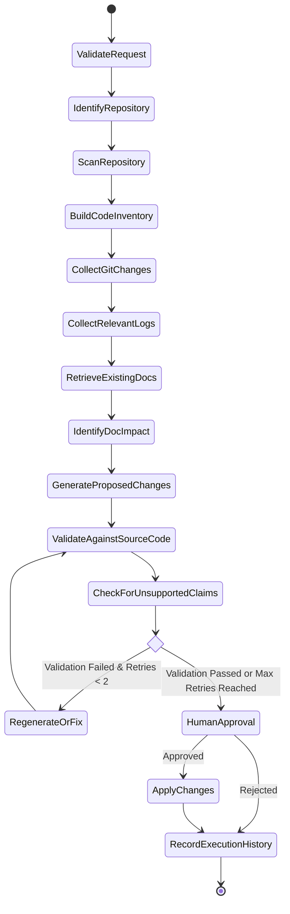

# System Architecture: Intelligent Documentation Agent

## 1. High-Level Architecture Overview

The Intelligent Documentation Agent is structured around a shared, headless **Documentation Engine** consumed by three client adapters:
1. **GitHub App Webhook Worker** (Cloud/CI execution)
2. **VS Code Extension** (Developer workspace interactive execution)
3. **CLI (`docagent`)** (Local workstation terminal & automation execution)

```mermaid
flowchart TD
    subgraph Clients["Integration Clients"]
        GH[GitHub Webhooks / PRs]
        VSC[VS Code Extension (TypeScript)]
        CLI[Terminal CLI (Typer / Rich)]
    end

    subgraph API["Backend API Layer (FastAPI)"]
        WebhooksRoute["/api/v1/webhooks/github"]
        JobsRoute["/api/v1/jobs"]
        ValidationRoute["/api/v1/validation"]
        LocalBridge["Local IPC / Subprocess Bridge"]
    end

    subgraph Engine["Shared Documentation Engine"]
        Scanner["Repository Scanner & Filter"]
        Parser["AST & Tree-sitter Parsers (Py, JS/TS)"]
        GitDiff["Git Change & Breaking API Analyzer"]
        LogAnalyzer["Multi-Source Log & CI Trace Analyzer"]
        Generator["Documentation Synthesizer"]
        Validator["Evidence Verifier & Drift Detector"]
    end

    subgraph Orchestration["LangGraph Workflow DAG"]
        State["Typed DocAgentState"]
        Checkpointer["Async SQLite / Postgres Checkpointer"]
        HumanReview["Human Review Node (Interruptible)"]
    end

    subgraph Storage["Persistence & LLM"]
        DB[(PostgreSQL / SQLite Database)]
        LLM[OpenAI-compatible LLM / NVIDIA NIM]
    end

    GH -->|HMAC-verified Webhook| WebhooksRoute
    VSC -->|REST / Local IPC| JobsRoute
    CLI -->|In-Process or REST| Scanner

    WebhooksRoute --> JobsRoute
    JobsRoute --> Orchestration
    LocalBridge --> Orchestration

    Orchestration --> Engine
    Engine --> Storage
    Generator --> LLM
    Validator --> DB
```

---

## 2. Core Engine Components & Module Boundaries

### 2.1 Repository Scanner (`docagent.analyzer.repo_scanner`)
- **Boundary**: Discovers workspace files without reading file payloads into memory unless authorized.
- **Responsibilities**:
  - Filter out ignored directories (`.git`, `node_modules`, `venv`, build targets, hidden files).
  - Enforce `.docagentignore` overrides.
  - Compute checksums (SHA-256) per file to detect incremental changes.
  - Return clean file tree references.

### 2.2 AST & Tree-sitter Code Understanding (`docagent.analyzer.ast_parser` & `treesitter_engine`)
- **Boundary**: Pure read-only structural inspection. Never executes imported code.
- **Responsibilities**:
  - Python: standard library `ast` parsing for classes, methods, docstrings, typing annotations, decorators, dependencies, and FastAPI/Flask route decorators.
  - JavaScript / TypeScript: `tree-sitter` queries parsing class definitions, functions, arrow functions, exported signatures, and Express/NestJS routes.
  - Return typed `CodeInventory` model representing modules, symbols, endpoints, and configuration schemas.

### 2.3 Git Change Analyzer (`docagent.analyzer.git_diff_analyzer`)
- **Boundary**: Git CLI / GitPython interface wrapper.
- **Responsibilities**:
  - Extract status between working tree and HEAD, or between two commit SHAs/branches.
  - Map modified files and lines to symbols identified in `CodeInventory`.
  - Detect API breaking changes: removed methods, renamed parameters without defaults, altered return types.
  - Produce a structured `GitChangeSet`.

### 2.4 Multi-Source Log Analyzer (`docagent.analyzer.log_analyzer`)
- **Boundary**: Ingests unstructured log text files or CI console outputs.
- **Responsibilities**:
  - Regex & heuristic pattern recognition for Python tracebacks, Node.js unhandled rejections, and GitHub Actions build steps.
  - Extract timestamps, severity, error classes, call frames, and error messages.
  - Cluster similar errors into unique signatures using normalized trace hashing.
  - Distinguish observed runtime facts from speculative root causes.

### 2.5 Documentation Synthesizer (`docagent.generator.doc_generator`)
- **Boundary**: Produces markdown documentation from grounded structural evidence.
- **Responsibilities**:
  - Render targeted documentation sections using standardized templates (README, Architecture, API Reference, Configuration, Troubleshooting, Changelog).
  - Use LLM provider abstraction with explicit system prompts, strict temperature (0.1), and token budgets.
  - Ground all generated descriptions with AST symbol references.

### 2.6 Evidence Verifier & Drift Detector (`docagent.validator`)
- **Boundary**: Validates documentation against source code truth.
- **Responsibilities**:
  - Extract claims from markdown documents: mentioned symbols, parameters, API routes, commands.
  - Validate against the active `CodeInventory`.
  - Flag missing symbols, hallucinated parameters, outdated signatures, or dead configuration keys.
  - Generate a structured `ValidationReport` with severity levels.

---

## 3. LangGraph Workflow Architecture

The execution pipeline is implemented as a finite state machine using LangGraph:



### Safety & Guardrails:
- **No Unbounded Loops**: Maximum 2 retry cycles on validation failure before surfacing findings to human review.
- **Interruptible State**: Checkpointer saves the exact execution state prior to `HumanApproval`. The agent pauses until explicit human input (Accept, Reject, Edit) is received via Webhook, VS Code UI, or CLI prompt.
- **Review-First Patching**: Documentation files are rendered to unified diff patches and presented for inspection.
