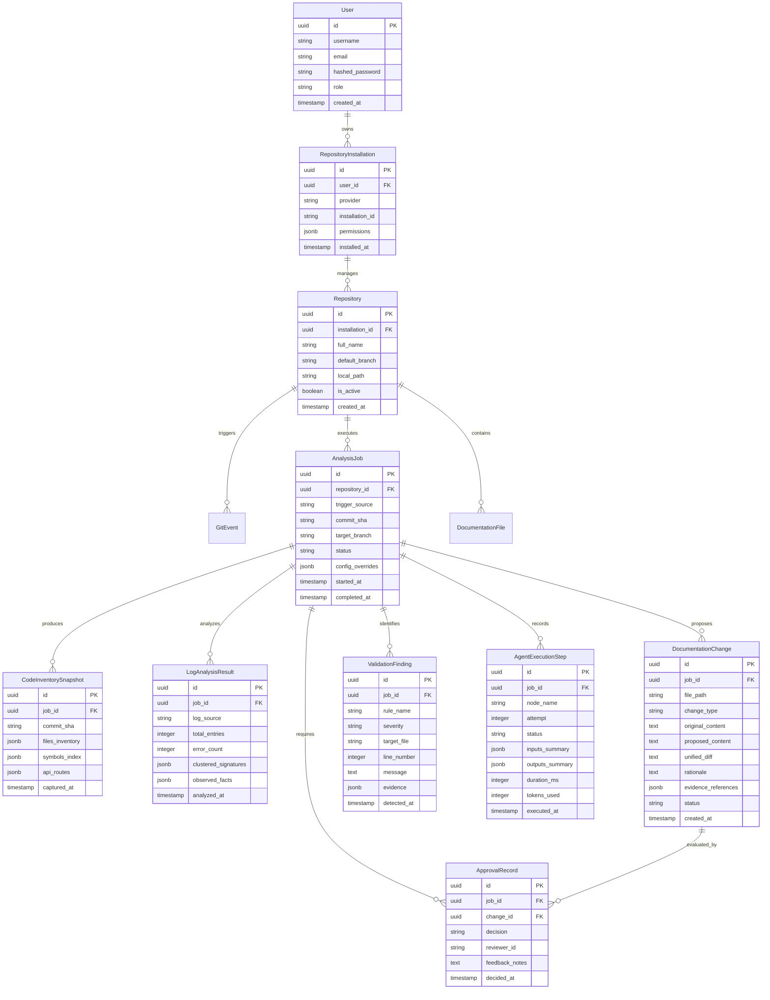

# Database Schema & Data Models: Intelligent Documentation Agent

## 1. Overview
The persistence layer supports both PostgreSQL (for production multi-tenant GitHub App deployment) and SQLite (for local single-user CLI and offline VS Code execution) using SQLAlchemy 2.0 ORM with asynchronous capabilities (`aiosqlite` and `asyncpg`).

---

## 2. Entity-Relationship Diagram (ERD)

---

## 3. Retention Policies & Indexing
1. **Idempotency Index**: Unique index on `(repository_id, commit_sha, trigger_source)` in `AnalysisJob` to prevent duplicate processing of re-sent webhooks.
2. **Fast Lookup Indexes**:
   - `AnalysisJob(repository_id, status)`
   - `DocumentationChange(job_id, status)`
   - `ValidationFinding(job_id, severity)`
3. **Data Retention**:
   - Intermediate execution step traces are pruned after 30 days.
   - Code inventory snapshots keep the latest 10 snapshots per repository.
   - Documentation change history and approval records are retained indefinitely for auditing.
